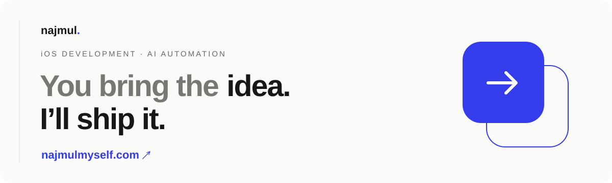

  <a href="https://najmulmyself.com"><strong>Portfolio</strong></a> &nbsp;·&nbsp;
  <a href="mailto:najmul.myself@gmail.com">Email</a> &nbsp;·&nbsp;
  <a href="https://www.linkedin.com/in/najmulmyself/">LinkedIn</a> &nbsp;·&nbsp;
  <a href="https://www.threads.com/@najmulmyself">Threads</a>

## Hi, I’m Najmul

An indie developer in Dhaka with 3+ years of experience taking mobile apps from first commit to store release. My current focus is **native iOS development** and **AI automation**, backed by hands-on Flutter experience across commercial products, a government VAT system, and my own apps.

I like the last part of building best: testing on a real device, fixing the rough edges, and getting something useful into people’s hands.

### What I can help with

- **iOS apps:** scope, design, development, TestFlight, App Store submission, and crash monitoring.
- **Flutter apps:** Android and iOS development, new features, bug fixes, and release preparation.
- **AI automation:** workflows for emails, spreadsheets, reports, and repetitive business tasks.
- **Contract support:** an extra developer for teams that value maintainable code, testing, and reliable releases.

### Selected work

| Product | What I worked on |
| --- | --- |
| [DLS Pro](https://play.google.com/store/apps/details?id=com.sakib.dreamkit) | Android football companion built, monetized, and launched solo. **500K+ downloads.** Flutter, Provider, and AdMob. |
| [Gold Kinen](https://play.google.com/store/apps/details?id=com.goldkinen.android) | Mobile engineering for a gold buying, selling, storing, and gifting platform. BLoC, Clean Architecture, payments, tests, and release workflows. |
| NBR VAT (EFDMS) | Government VAT system work involving fiscal devices, offline sync, PDF generation, and encryption. |
| [Stayverz](https://play.google.com/store/apps/details?id=com.stayverz.stayverz) | Hotel booking app with reservations and payment integration. |
| [Skill Finesse](https://apps.apple.com/us/app/skill-finesse/id6477940594) | Learning platform for iOS and Android with course tracking and push notifications. |

[Explore more apps and my process →](https://najmulmyself.com/#work)

### Engineering background

**Mobile:** Flutter · Dart · BLoC · Provider · Riverpod  
**Architecture and quality:** Clean Architecture · dependency injection · TDD · unit and widget tests  
**Firebase:** Authentication · Firestore · Crashlytics · Remote Config · Cloud Messaging  
**Delivery:** GitHub Actions · Firebase App Distribution · App Store and Play Store releases  
**Integrations:** bKash · Stripe · AdMob

### Have an idea or a task to automate?

Tell me what you want to build. I’ll help you figure out the first useful version.

**[Let’s talk at najmulmyself.com →](https://najmulmyself.com/#contact)**

Open to freelance projects, contract work, and remote opportunities. Based in Dhaka, GMT+6.
